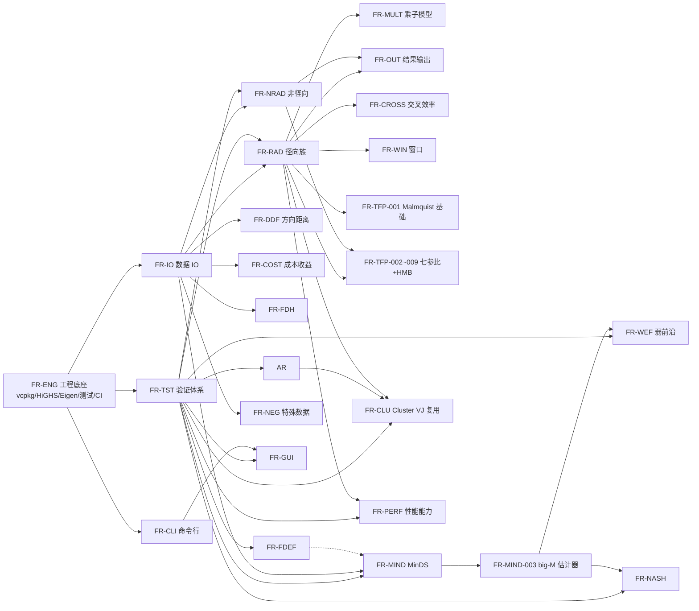

# OpenSuperDEA 需求拆解清单（SRS 配套，阶段一产出物）

> 版本：V0.3 ｜ 2026-10-24 ｜ 配套：design_docs/00_srs.md
> 方法：software-requirements-engineer 技能「四步拆解法」（目标识别 → 功能提取 → 需求分类 → 需求补全）
> 状态流转：pending 经用户确认后转 confirmed；assumption 经用户认可后转 confirmed；derived 被异议后回退 pending。

## 1. 需求来源

| 来源 | 说明 | 效力 |
|---|---|---|
| tmp/zcode_0_prompt.md | 项目启动提示词（M1 版 v0，用户显式指定读取） | 最高（confirmed 主源） |
| docs/project_context.md | 会话知识固化（技术栈/算法路线/验证体系/里程碑） | 最高（confirmed 主源） |
| README.md / AGENTS.md / naming_convention.md / docs/decision_log.md | 项目门面与工程约束 | 高（confirmed/约束） |
| research_docs/m0_presearch_report.md | M0 预研（可行性 + 功能全景 + 风险） | 高（confirmed/derived 依据） |
| research_docs/unique_algorithms_survey.md v4.0 | 10 项独有算法路线（论文 + 对拍 + 黄金算例） | 高（算法需求事实源） |
| research_docs/01_maxdea_software_overview.md / 02_online_dea_platform_survey.md | MaxDEA 功能清单细节（ERM/加性族/交叉效率/DDF 方向等） | 中（derived 依据，不重新上网调研） |
| 用户会话确认（AskUserQuestion + 计划批准） | 瀑布·阶段门禁 / Markdown 落库 / 依赖全量预装（DR-005） | 最高 |

## 2. 目标识别（第一步）

- **目标陈述**：用 C++ 全量实现商业软件 MaxDEA X 的全部功能——常规模型族 + 10 项独有算法 + 万级/百万级 DMU 极速求解；CLI 先行（M1-M5），GUI 后置（M6，Qt6）；支持 Ubuntu（WSL）/ Windows，macOS 后期。
- **目标用户**：DEA 研究者与研究生（论文复现、大规模测算）、数据分析师（批量脚本化测算）、后续 GUI 用户（M6）。
- **成功标准**：①常规模型与 deaR/PyDEA 全量对拍误差 < 1e-6；②10 项独有算法逐项黄金算例复现（误差 < 1e-6，EBM ρ/ε 达 1e-8）；③性能对标官方（10 万 DMU 3×3 BCC 参照 25.32s、100 万 DMU 3×3 CCR 参照 106s）；④三段式 CI 全绿。
- **核心约束**：C++17（现骨架）→ C++20（引擎期，升级需用户确认）；HiGHS/Eigen/CLI11/Qt6/QHULL 依赖边界；GPL 工具只对拍不移植；naming_convention.md 单一事实源；未经确认不 push；调研已固化不得重新全网调研。

## 3. 功能提取汇总（第二步，模块级）

完整 FR 明细见 00_srs.md 第 3 章（共 116 条）；此处为模块级汇总。

| 模块 | FR 区间 | 条数 | 版本（里程碑） | 主来源 |
|---|---|---|---|---|
| 工程底座 | FR-ENG-001~008 | 8 | V0.1.0（M1） | 启动提示词 §6 任务 2/5/6 |
| 数据 IO | FR-IO-001~009 | 9 | V0.1.0~V0.2.0（M1/M2） | 任务 4/5；M0 技术栈 |
| 命令行 | FR-CLI-001~008 | 8 | V0.1.0 起（M1/M2/M5） | 任务 3；README CLI 草案 |
| 结果输出 | FR-OUT-001~006 | 6 | V0.2.0（M2） | 验证体系隐含需求 |
| 径向族 | FR-RAD-001~005 | 5 | V0.2.0（M2） | M2 清单；MaxDEA 功能表 |
| 非径向族 | FR-NRAD-001~007 | 7 | V0.2.0/V0.5.0 | M2/M5 清单；算法调研 §5/§9 |
| 方向距离 | FR-DDF-001~003 | 3 | V0.2.0（M2） | MaxDEA 功能表（4 种方向向量） |
| 成本收益 | FR-COST-001~003 | 3 | V0.2.0（M2） | M2 清单 |
| FDH | FR-FDH-001 | 1 | V0.2.0（M2） | M2 清单 |
| 乘子模型 | FR-MULT-001~002 | 2 | V0.2.0（M2） | MaxDEA 功能表 |
| 交叉效率 | FR-CROSS-001~004 | 4 | V0.2.0（M2） | README；01 调研（DG/Ruiz/自定义） |
| 窗口分析 | FR-WIN-001 | 1 | V0.2.0（M2） | README |
| 特殊数据 | FR-NEG-001~004 | 4 | V0.2.0/V0.5.0 | survey §13；M0 功能表 |
| MinDS | FR-MIND-001~003 | 3 | V0.5.0（M5） | 算法调研 §1 |
| FDEF | FR-FDEF-001~004 | 4 | V0.5.0（M5） | 算法调研 §2 |
| 弱前沿最近距离 | FR-WEF-001~003 | 3 | V0.5.0（M5） | 算法调研 §3 |
| AR/Cone | FR-AR-001~004 | 4 | V0.5.0（M5） | 算法调研 §8 |
| 博弈交叉效率 | FR-NASH-001~002 | 2 | V0.5.0（M5） | 算法调研 §4 |
| Cluster 8 基准 | FR-CLU-001~012 | 12 | V0.5.0（M5） | 算法调研 §7（Seiford-Zhu 精读） |
| TFP 族 | FR-TFP-001~009 | 9 | V0.2.0/V0.5.0 | 算法调研 §6/§10 |
| 性能能力 | FR-PERF-001~005 | 5 | V0.3.0/V0.4.0（M3/M4） | M0 §5；Zhu-Wu-Song 2018 |
| 验证体系 | FR-TST-001~006 | 6 | V0.1.0 预留起 | 启动提示词 §7 |
| GUI | FR-GUI-001~007 | 7 | V0.6.0（M6） | project_context M6 行 |

## 4. 需求分类映射（第三步）

| 分类 | 去向 |
|---|---|
| 功能需求 | SRS 第 3 章（23 模块，117 条 FR） |
| 非功能需求 | SRS 第 4 章（性能/兼容/可维护/合规/可用性，NFR 编号） |
| 约束条件 | SRS 2.4（技术栈/规范/许可/Git 纪律） |
| 外部接口 | SRS 第 5 章（HiGHS/Eigen/CLI11/QHULL/Qt6 API + 对拍外部进程 Rscript/python） |

## 5. 需求补全记录（第四步）

### 5.1 derived（合理推导，纳入并标注依据）

| 项 | 推导依据 |
|---|---|
| 退出码分类规范（0/1 参数/2 数据/3 求解/4 内部） | M1 任务 3 要求「退出码规范」，具体分类为工程推导 |
| 定向/RTS 作为 run 选项参数（而非独立命令） | MaxDEA 以模型组合参数化；README run 示例含 --orientation/--rts |
| 结果同时含效率值/投影/参考集/λ/slack | L2 黄金算例对拍需 λ* 与投影值（Seiford-Zhu Table 3-6 含 λ*） |
| 错误信息含错误码与修复提示 | 「缺列/非数值/空数据有明确报错」的工程化展开 |
| 利润效率（P2） | 成本+收益模型的自然组合；Benchmarking/DEA Toolbox 均含 |
| 乘子-包络对偶一致性检验 | DEA 数学性质，验证体系 L3 的组成部分 |
| 离线本地计算，无网络依赖 | 所有模型为本地 LP/MILP 求解；对拍外部进程亦本地 |
| 测试用例命名引用 FR 编号 | 决策记录 DR-005「需求-设计-代码-测试同链追溯」 |

### 5.2 assumption（合理技术假设，纳入并显式标注）

| 编号 | 假设内容 | 依据/风险 |
|---|---|---|
| （说明） | A-001~A-008 已于 2026-10-24 随 SRS V1.0 定稿获用户认可，转为 confirmed | |
| A-001 | Weak EF 弱投影取第一可行解并在文档标注不唯一性 | M0 风险表缓解方案（P2 风险） |
| A-002 | FDEF 的 NDRS/NIRS 延后（P2），CRS/VRS 先闭环 | M0 风险表；文献稀缺 |
| A-003 | Cluster 8 基准按 Seiford-Zhu 2003 参考集组合参数化实现 | 算法调研 §7（无公开实现，黄金算例兜底） |
| A-004 | 测试框架选 GoogleTest | 计划已获批（vcpkg 一等支持 + CTest 集成） |
| A-005 | 里程碑↔版本号映射：M1=V0.1.0 … M7=V0.7.0，M8=V1.0.0 | 语义化版本惯例推导 |
| A-006 | 对拍工具以开发机安装的 R/Python 包运行（外部进程） | 验证体系定义「独立于产品源码」 |
| A-007 | CLI 消息英文、文档中文 | 跨平台最小依赖；用户偏好中文文档 |
| A-008 | big-M 自动估计器为 M5 共用前置组件（MinDS/Nash/WeakEF） | 算法调研 §3.2 共性风险缓解 |

### 5.3 pending → 已裁决（2026-10-24 用户确认：全部按建议）

> 原 14 项 pending 已随 SRS V1.0 定稿全部裁决，裁决结果见 00_srs.md 附录 8.2。下表为裁决前原始记录（留档）。

| 编号 | 事项 | 建议 |
|---|---|---|
| P-001 | Excel IO 版本归属（M0 技术栈含 xlsx，M1 任务仅 CSV） | 归扩展功能，M6 GUI 期实现 |
| P-002 | 性能判定基准：严格 ≤ 官方值 vs 同量级（官方参照：10 万 BCC 25.32s、100 万 CCR 106s）；测试硬件口径 | 同量级（≤ 官方 × 1.2）并记录硬件 |
| P-003 | push 与三段式 CI 衔接（Actions 需 push 触发，push 禁令需用户确认） | 每里程碑收尾一次性确认 push |
| P-004 | CLI 子命令集定版（README 草案 run/cluster/compare vs M1 任务 run/version/check） | M1=version/check/run 骨架，M2 run 全参数，cluster 随 M5 |
| P-005 | C++17→C++20 升级时点（不可自行升级） | M2 启动时评估并经确认 |
| P-006 | 加权加性族「9 种子模型」精确清单（本地已得候选：ADD/归一化加权/RAM/BAM/DSBM 等） | 设计期对照本地 01 调研文档核定 |
| P-007 | 面板数据 CSV schema（长表 vs 宽表） | 长表（DMU, period, in*, out*） |
| P-008 | 非期望产出/非自由处置模型版本归属（M0 功能表有、M2 清单无） | 扩展功能或 M2 可选批 |
| P-009 | 单元测试覆盖率门槛与度量工具 | core 行覆盖 ≥ 80%，llvm-cov/gcovr |
| P-010 | L1 对拍容差（跨实现浮点差异可能超 1e-6） | L2 论文算例 1e-6 严格；L1 对拍 1e-6 或相对误差 1e-9 |
| P-011 | 结果输出默认格式（CSV 主/JSON 可选？） | CSV 默认，--format json 可选 |
| P-012 | compare 子命令是否纳入正式范围 | M5 后按需评估 |
| P-013 | Windows 原生构建工具链（MSVC/clang-cl/MinGW） | MSVC（Actions windows-latest 默认） |
| P-014 | 性能基准硬件环境记录要求 | 基准报告强制记录 CPU/内存/系统版本 |

## 6. 交叉复审发现的歧义与缺口（来源文档互核）

| # | 发现 | 涉及文档 | 处置 |
|---|---|---|---|
| 1 | Excel IO：M0 技术栈列入「CSV / Excel 导入导出」，但 M1 任务清单仅 CSV | m0 §6.2 vs prompt §6 | P-001 待裁决；默认扩展功能 |
| 2 | 性能目标口径：文档均为「对照官方 25.32s」，未定义达标判定与硬件口径 | m0 §5 / prompt §7 | P-002/P-014 待裁决 |
| 3 | push 禁令与 CI 三段式存在流程张力（Actions 需 push 触发） | prompt §3.2/3.3 | P-003 待裁决；执行时逐次请示 |
| 4 | CLI 子命令两处口径不一（README 草案 vs M1 任务） | README §使用示例 vs prompt §6.3 | P-004 待裁决 |
| 5 | C++20 升级时点未定（提示词：引擎实现期规划、不可自行升级） | prompt §4 | P-005 待裁决 |
| 6 | 「加权加性族 9 种子模型」无精确清单；本地调研已得候选（简单加性、归一化加权、RAM、BAM、DSBM 等） | 01 调研 §一.2 | P-006；以本地文档核定，不上网 |
| 7 | 非期望产出/非自由处置在 M0 功能全景出现但未入 M2 清单 | m0 §2.1 vs §7 | P-008 待裁决 |
| 8 | ERM 已就地澄清：增强 Russell 测度，与 SBM 并列的「最大距离」度量（非同义词） | 01 调研 §一.2 | 已解决，写入 SRS |
| 9 | 交叉效率明细已就地澄清：DG I/II=攻击/仁慈，Ruiz 2013 两类，自定义虚拟 DMU 仁慈/攻击型 | 01 调研 §一.2 | 已解决，写入 SRS |
| 10 | DDF 方向向量集已就地澄清：DMU 自身/均值/单位向量/RDM/自定义 | 01 调研 §一.2 | 已解决，写入 SRS |
| 11 | 官方百万级基准补充：100 万 DMU 3×3 CCR ≈ 106s（02 调研），可作为 M4 L4 参照 | 02 调研 §平台表 | 已写入 SRS NFR |
| 12 | M2 含「Malmquist 基础」，M5 含「Malmquist 7 参比」——两级实现，避免重复设计 | prompt §5 vs project_context §5 | SRS 按两级规划（FR-TFP-001 M2；002~009 M5） |
| 13 | 偏好（加权）模型归属：survey §13 明确「归 M2 常规功能」 | survey §13 | confirmed（FR-NEG-001，M2） |
| 14 | 32 打印机黄金数据（分层 + Table 3-6 + λ*）已落库，可直接作 Cluster 测试基准 | survey §7.3 | FR-TST-003 资产确认 |

## 7. 需求依赖关系

关键依赖说明：
- big-M 估计器（FR-MIND-003）是 MinDS/Nash/WeakEF 的共用前置，实现顺序上先于三者。
- FDEF(CRS) 与 MinDS 共享前沿刻画基础（算法调研实现顺序：FDEF → MinDS → 扩展面）。
- AR 权重下界与 Cluster VJ 版打通（Seiford-Zhu §3.3），二者实现需接口复用。
- 验证体系（FR-TST）自 M1 预留接口，M2 起逐里程碑承载对拍/算例/性质/性能四层验证。

## 8. 状态统计

| 状态 | 条数（FR 级） | 说明 |
|---|---|---|
| confirmed | 118 | 96 原始确认 + 14 项 pending 裁决转正（2026-10-24）+ 8 项 assumption 定稿认可 |
| derived | 8 | 见 §5.1 |
| assumption | 0（全部转 confirmed） | 见 §5.2 |
| pending | 0（全部裁决） | 见 §5.3 与 SRS 附录 8.2 |
| 合计 | FR 116 条 + NFR 21 条 | SRS V1.0 定稿（2026-10-24） |
