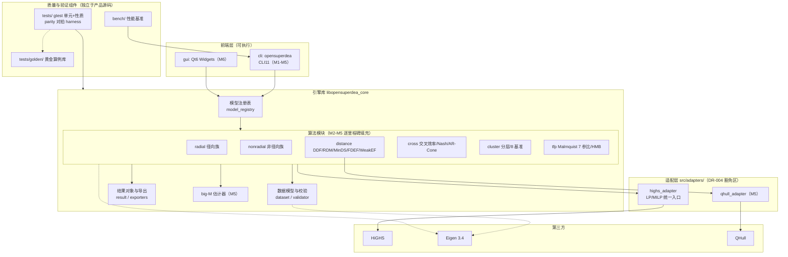
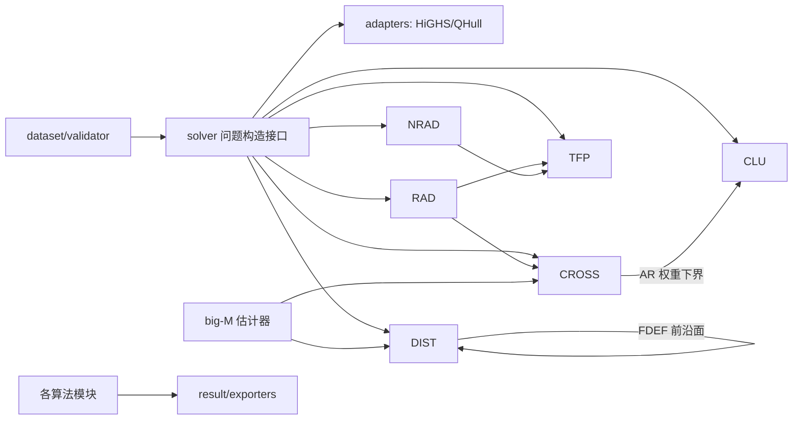
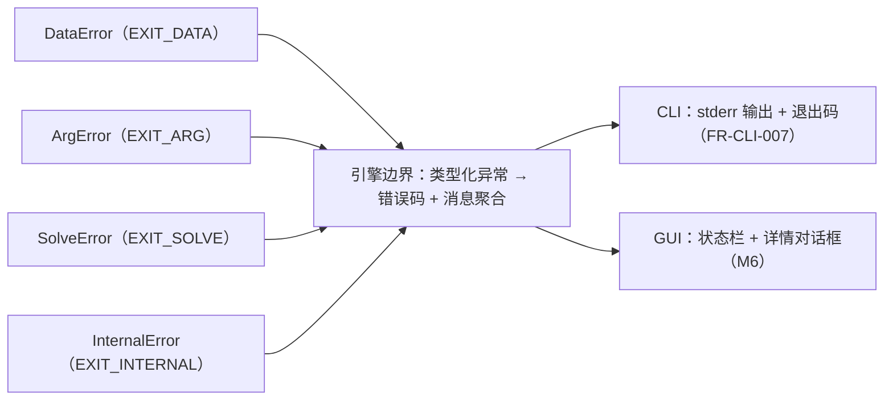

# 01 总体设计（Overall Design）

> 版本：V1.0 ｜ 2026-10-24 ｜ 依据：SRS V1.0（DR-006）、M0 报告 §6.3 架构分层、DR-001~006
> 范围：系统架构、模块划分与依赖、关键机制（模型注册表/参考集/错误处理）、目录结构、技术演进策略。M2-M5 各里程碑的算法级详细设计另行分册（06+，里程碑启动时产出）。

## 1. 设计目标与原则

| 原则 | 落实 |
|---|---|
| 单一引擎源 | CLI 与 GUI（M6）调用同一引擎库，禁止算法分叉（FR-GUI-007） |
| 模型即插件 | 全部模型经统一模型注册表暴露，CLI/GUI/测试零特判（支撑 3 万+ 组合能力） |
| 第三方隔离 | 第三方 API 直调仅限 src/adapters/（DR-004），业务层只见内部接口 |
| 验证即架构 | 对拍/算例/性质/性能四层验证（L1-L4）作为 tests/bench 一等公民组件设计 |
| 数值纪律 | 双精度 + 双阈值容差（P-010）；big-M 统一估计器（FR-MIND-003）；无隐藏随机性 |

## 2. 系统架构分层



要点：

- **引擎库先行**：M1 即建立 `libopensuperdea_core`（静态库）+ CLI 可执行两层目标，M6 GUI 直接链接引擎库，避免「CLI 主程序被 GUI 复用」的倒挂。
- **tests/bench 只依赖公开接口**：对拍 harness 经 CLI 可执行 + 结果文件交互，不走内部头文件（许可与稳定性双保险）。

## 3. 模块依赖关系



关键依赖裁决（对齐 SRS 与算法调研实现顺序）：

| 依赖 | 说明 |
|---|---|
| FDEF(CRS) → MinDS | 扩展面最近目标（FR-MIND-002）复用 FDEF 前沿面枚举；M5 内先 FDEF 后 MinDS |
| big-M → MinDS/Nash/WeakEF | 三模型共用估计器，先行实现（FR-MIND-003） |
| AR ↔ Cluster VJ | 权重下界接口打通（FR-AR-004），两侧共用「乘子界限」数据结构 |
| 距离函数内核 → TFP 族 | Malmquist/HMB 全部参比共享逐点距离求解；M2 建 adjacent 基础，M5 扩 7 参比 |

## 4. 关键机制设计

### 4.1 模型注册表（model registry）

- 注册单元：`model_id`（如 `ccr`、`sbm`、`mind`）→ 描述符（支持的 orientation × RTS 集合、结果列集、参数 schema、能力矩阵条目）→ 工厂（`create(data, options) → Result`）。
- 消费方：`run` 子命令（FR-CLI-003）、参数校验（FR-CLI-008 读能力矩阵）、GUI 配置面板（FR-GUI-002 复用矩阵）、compare/批量（EX-004/005）。
- 组合表达：`model × orientation × rts × options` 一次查表判定合法性与列集，杜绝散落的 if-else。

### 4.2 参考集（reference set）抽象

- 统一「哪些 DMU 进入约束」的选择器：`all`（常规）/ `exclude_self`（超效率）/ `layer(l)`（Cluster 分层）/ `group(g)`（self/cross 群组）/ `window(t,w)`（窗口）/ `fixed(T*)`（固定基准）/ `period_pair(t,s)`（Malmquist 参比）。
- 意义：Cluster 8 基准（A-003）与 Malmquist 7 参比（FR-TFP-002~007）本质都是参考集组合规则参数化——一个抽象服务两个独有算法族，是本项目架构层面最核心的复用点。

### 4.3 错误处理策略



- 引擎内部抛类型化异常（`DataError/ArgError/SolveError/InternalError`，携带 code/location/hint 三元组）；边界统一捕获转错误码。
- 数据校验错误聚合输出（单次报全部，FR-IO-005）；求解器状态（不可行/无界/迭代上限）映射 `SolveError` 子码，不崩溃。

### 4.4 数值与求解策略

- 全部 LP/MILP 经 `highs_adapter` 单一入口：双精度、确定性选项（固定线程内层、关闭对数输出），保证可复现（NFR 可复现性）。
- big-M 估计器输出 M 值 + 条件数审计，M5 三消费模型共享（NFR-PERF-005）。
- M3/M4 性能路径在引擎库内部加「并行调度 + 稀疏分块」两个正交开关，不改变数值语义（FR-PERF-001~004）。

## 5. 目录结构设计

```text
OpenSuperDEA/
├── CMakeLists.txt / CMakePresets.json / vcpkg.json
├── src/
│   ├── main.cpp                  # CLI 入口（仅装配，无业务）
│   ├── cli/                      # 子命令、参数解析、退出码映射
│   ├── core/                     # 引擎库（见架构图）
│   │   ├── dataset/  solver/  registry/  result/
│   │   ├── radial/  nonradial/  distance/  cross/  cluster/  tfp/
│   │   └── numeric/              # big-M 估计器等数值公共件
│   └── adapters/                 # HiGHS/QHull 适配（DR-004 豁免）
├── tests/
│   ├── unit/                     # gtest 单元+性质（按里程碑分目录）
│   ├── golden/                   # L2 黄金算例库（FR-IO-008）
│   └── parity/                   # L1 对拍 harness（python，外部进程）
├── bench/                        # L4 性能基准（M3 起）
├── scripts/  design_docs/  research_docs/  docs/
└── tmp/                          # 过程文件（不入库）
```

命名遵循 naming_convention.md（目录/文件 snake_case，CMake 变量 `OPENSUPERDEA_` 前缀）。

## 6. 技术演进策略

| 阶段 | 演进动作 |
|---|---|
| M1 | C++17；引擎库/CLI 双目标；gtest+ctest；CI 三段式 |
| M2 启动 | C++20 升级评估（P-005：报 naming_convention/.clang-tidy 影响后经用户确认） |
| M2 | 模型注册表 + 参考集抽象落地；radial/nonradial/cost/ddf/cross/window 填充 |
| M3/M4 | 引擎内并行调度与稀疏分块开关（不动公开接口） |
| M5 | distance/cross/cluster/tfp 独有算法 + big-M 估计器 + qhull_adapter |
| M6 | gui/ 目录恢复 Qt6 骨架（tmp/gui_skeleton 迁回），仅前端层 |

## 7. 需求追溯

本册覆盖 SRS：FR-ENG-002/003/004/008（架构落点）、FR-CLI-008 与 FR-GUI-002/007（注册表消费）、FR-CLU 参考集参数化（A-003）、FR-MIND-003（numeric 落点）、C-01~C-09 约束映射。逐条实现设计见 02（数据）、03（M1）、06+（各里程碑算法册）。
