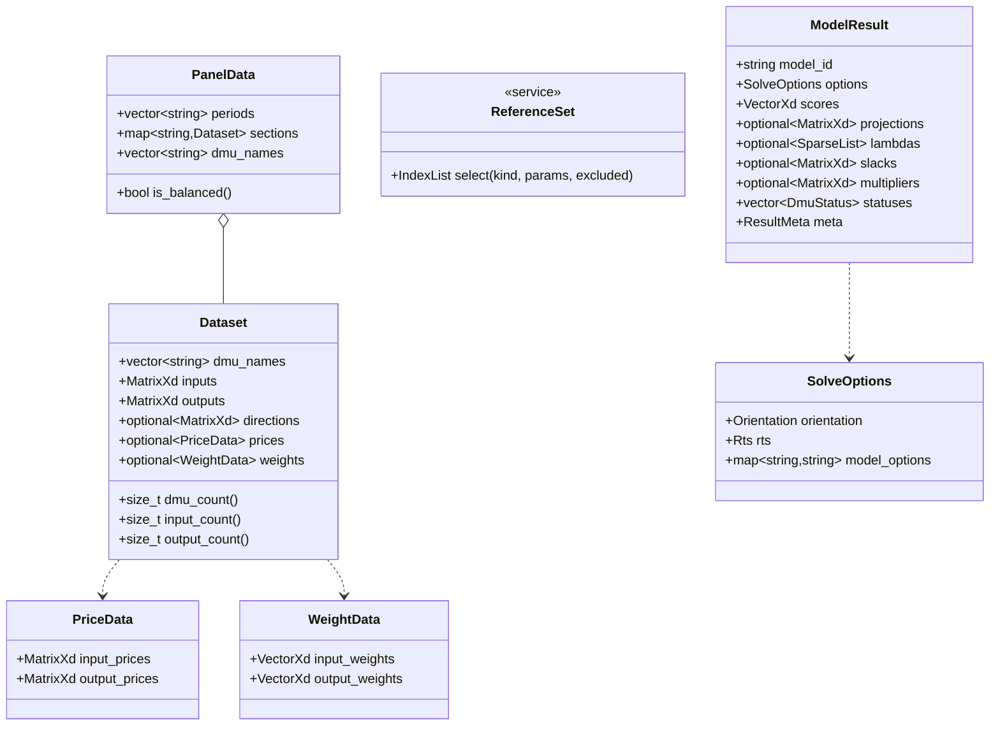

# 02 数据设计（Data Design）

> 版本：V1.0 ｜ 2026-10-24 ｜ 依据：SRS V1.0 FR-IO/FR-ENG-004/FR-OUT、P-007/P-011 裁决、01 总体设计
> 范围：核心数据结构（C++ 概要级）、CSV schema 规范、校验规则表、结果结构与导出格式。类内方法签名等实现细节留待编码期，本册定契约。

## 1. 核心数据结构



约定：

- 矩阵一律 Eigen `MatrixXd`（列主序默认）；M3/M4 大规模路径在 solver 层转稀疏表示，`Dataset` 接口不变（FR-PERF-004）。
- `ReferenceSet` 是服务而非数据：由算法模块按需调用，`Dataset`/`PanelData` 不感知 Cluster/TFP 语义。
- 成员命名遵循 naming_convention.md（snake_case + 可选 `_` 后缀；类型 PascalCase）。

## 2. CSV Schema 规范（P-007/P-011 裁决定案）

### 2.1 截面数据（基本）

```text
dmu,in_labor,in_capital,out_revenue,out_profit
A,120.5,30,880,92
B,……
```

- 首列：`dmu`（DMU 名，字符串，唯一性校验）；表头其余列按前缀识别角色：
  - `in_*` 投入列（m 列）；`out_*` 产出列（s 列）——**角色由前缀声明，不再依赖 CLI 指定区间**（CLI 选项可覆写，见 2.4）。
- 编码 UTF-8、逗号分隔、首行表头；`#` 起始行为注释，空行跳过。

### 2.2 扩展列前缀

| 前缀 | 含义 | 消费方 | 版本 |
|---|---|---|---|
| `di_* / do_*` | 自定义方向向量（输入侧/输出侧） | FR-DDF-003 | M1 读入 |
| `pi_* / po_*` | 投入/产出价格 | FR-COST-001/002/003 | M2 |
| `w_in_* / w_out_*` | 偏好固定权重 | FR-NEG-001 | M2 |
| `group_*` | 群组标签（Cluster self/cross） | FR-CLU-002/003 | M5 |
| `d_* / u_*` | AR/Cone 乘子界限（α、β 或虚拟 DMU 乘子） | FR-AR-001~004 | M5 |

### 2.3 面板数据（长表，P-007 裁决）

```text
dmu,period,in_labor,in_capital,out_revenue
A,2019,……
A,2020,……
```

- `period` 列必填（数值或字符串期次，输出时保持原样）；同一 (dmu, period) 唯一。
- 不平衡面板：允许缺失 (dmu, period) 组合，读入时告警（FR-IO-004）；Malmquist 相邻参比要求相邻两期交集非空，否则该 DMU 该期跳过并记录。

### 2.4 解析规则

- 数值：接受整数/小数/科学计数；千分位逗号不接受。
- 表头校验：角色前缀必须成组完整（如方向列数量 = m、s）；未知前缀列默认忽略并摘要提示（向后兼容，NFR-COMPAT-003）。
- CLI 覆写：`--inputs c1,c2 --outputs c3`（列名显式指定，无前缀要求）优先于前缀推断。

## 3. 数据校验规则表（FR-IO-005）

| 规则 ID | 条件 | 错误码 | 提示要点 |
|---|---|---|---|
| V-001 | 文件不存在/不可读 | EXIT_DATA | 路径与权限 |
| V-002 | 空文件/无表头/无数据行 | EXIT_DATA | 「空数据」三类分别报 |
| V-003 | 缺少 `dmu` 或无任何 in_/out_ 列 | EXIT_DATA | 指明缺失角色 |
| V-004 | 非数值单元格 | EXIT_DATA | 文件:行号:列名:原值 |
| V-005 | DMU 名重复/空 | EXIT_DATA | 重复名单（前 10 个） |
| V-006 | 方向/价格/权重列数与 m、s 不匹配 | EXIT_DATA | 期望 vs 实际列数 |
| V-007 | 全零投入或全零产出行 | EXIT_DATA | 行号 + 建议剔除 |
| V-008 | 负值出现在不允许负值的模型输入 | EXIT_DATA（模型相关，M5 修正 SBM 放行） | 提示换模型或清洗 |
| V-009 | 面板 (dmu,period) 重复 | EXIT_DATA | 重复组合列表 |
| V-010 | 价格 ≤ 0 / 权重和 ≠ 1 等模型前置 | EXIT_DATA | 规则名与期望 |

实现形态：规则表驱动（`vector<Rule>` 顺序执行、错误聚合），单元测试逐规则一用例（FR-TST-006 命名规范）。

## 4. 结果结构与导出格式

### 4.1 CSV 导出（默认，P-011）

- 文件命名：`<outdir>/<model>_<orientation>_<rts>_result.csv`（面板/Cluster 附期次或层级后缀）。
- 列集由模型注册表描述符声明（01 册 §4.1）：公共列 `dmu, score, status` + 模型特有列（projection_*, lambda_*, slack_*, mult_*）分块排列。
- 数值格式：10 位有效数字（对拍容差 1e-6/相对 1e-9 之下留 4 位余量）。

### 4.2 JSON 导出（--format json）

```json
{
  "meta": { "model": "ccr", "orientation": "in", "rts": "crs",
            "version": "0.2.0", "timestamp": "…", "elapsed_ms": 123,
            "data_sha1": "…" },
  "results": [ { "dmu": "A", "score": 0.8123456789, "status": "inefficient",
                 "projection": {"in_labor": 98.0}, "lambdas": {"B": 0.6, "C": 0.4},
                 "slacks": {"out_profit": 12.0} } ],
  "warnings": [ … ]
}
```

- `data_sha1`：数据文件指纹，供 compare（EX-004）与对拍 harness 判定同源。
- JSON 产出即对拍 harness 的产品侧输入（04 册 §3）。

### 4.3 状态枚举（跨模型统一）

`efficient / inefficient / super_efficient / infeasible / non_unique_note`（WeakEF 非唯一标注，A-001）。

## 5. 与黄金算例库的对接

- `tests/golden/<case>/data.csv` **必须**符合本册 schema（含 `in_/out_` 前缀与 `dmu` 列）；`expected.csv` 列名对齐 4.1 列集，保证 L2 断言零转换。
- 出处与容差记录于算例 `README.md`（FR-IO-008）；32 打印机算例需同时携带群组列（Cluster 用）。

## 6. 需求追溯

FR-IO-001~008（schema/校验/导出）、FR-ENG-004（结构定义）、FR-OUT-001~006（列集）、FR-DDF-003/FR-COST/FR-NEG-001/FR-AR/FR-CLU（扩展列前缀）、NFR-COMPAT-003（向后兼容）、P-007/P-010/P-011 裁决落点。
