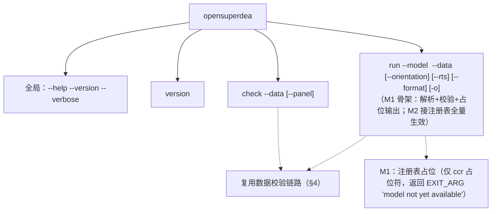
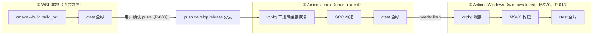
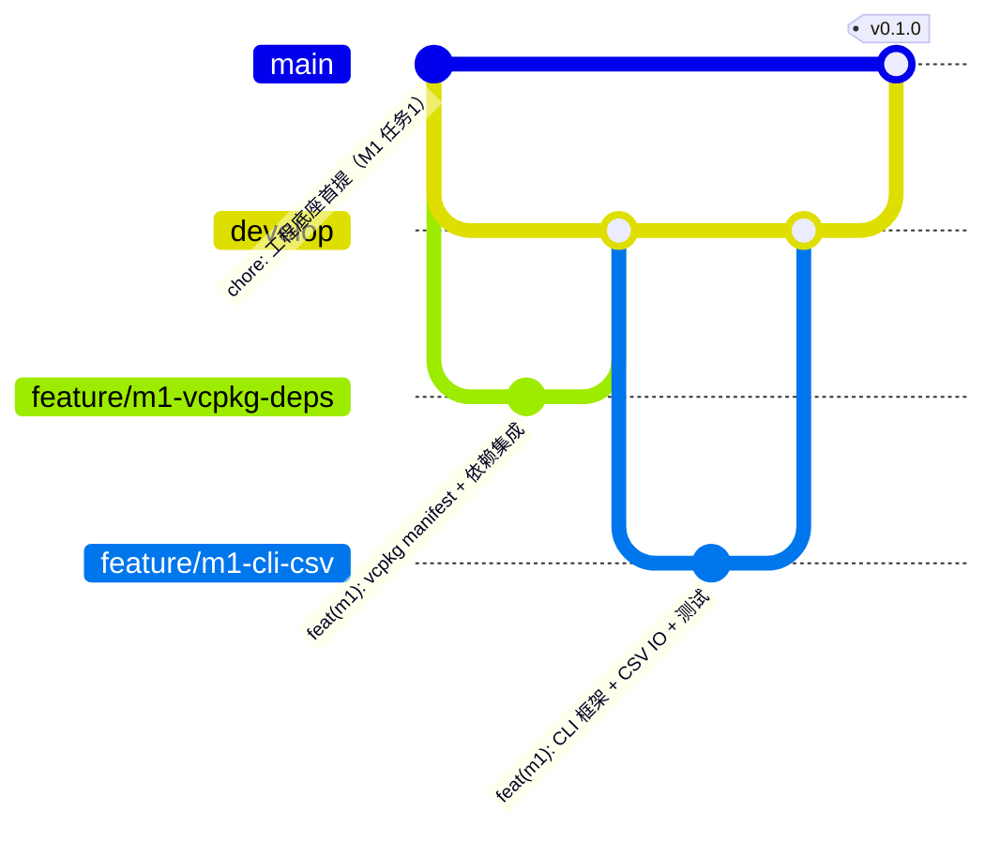

# 03 M1 工程底座详细设计（M1 Engineering Base）

> 版本：V1.0 ｜ 2026-10-24 ｜ 依据：SRS V1.0（FR-ENG/FR-IO-001~005/FR-CLI-001~003/006/007、FR-TST-001/006）、启动提示词 §6 M1 六任务、01/02 册
> 范围：vcpkg 集成、HiGHS 适配层、CLI 框架、数据 IO、测试与 CI、git flow 初始化。**M1 不含任何算法实现**（首个模型属 M2）。

## 1. M1 任务分解与验收对照

| 任务（提示词 §6） | 本册章节 | SRS 追溯 | 验收证据 |
|---|---|---|---|
| 1 首次本地 git 提交 | §7 + 05 册 | C-05 | `git log` 首条 commit；未 push |
| 2 vcpkg + 依赖集成 | §2 | FR-ENG-001/003 | 全新 `build_m1/` 配置编译成功；三方最小示例可运行 |
| 3 CLI 框架（CLI11） | §3 | FR-CLI-001/002/003/006/007 | --help/--version/子命令解析正确；退出码规范 |
| 4 CSV 数据 IO | §4 | FR-IO-001/002/005 | 黄金算例读入；缺列/非数值/空数据明确报错 |
| 5 核心数据结构 | 02 册 §1 | FR-ENG-004 | 单元测试覆盖序列化/存取 |
| 6 三段式 CI + 测试框架 | §5/§6 | FR-ENG-005/006、FR-TST-006 | WSL 全绿 → Actions Linux 全绿 → Actions Windows 全绿 |

## 2. vcpkg 集成设计（任务 2）

### 2.1 清单与预设

- `vcpkg.json`（manifest，baseline 取当前 vcpkg 官方主分支）：

```json
{
  "name": "opensuperdea",
  "version-string": "0.1.0",
  "dependencies": ["eigen3", "highs", "cli11", "gtest"]
}
```

（M5 追加 `qhull`；Qt6 走系统 apt + find_package，不入 vcpkg——与 DR-005 全量预装一致，vcpkg 端口仅承载需源码构建项。）

- `CMakePresets.json`：`default`（WSL，GCC）与 `win-msvc`（CI）两个配置预设，均注入 `CMAKE_TOOLCHAIN_FILE=$VCPKG_ROOT/scripts/buildsystems/vcpkg.cmake`；`vcpkg` 二进制缓存（`VCPKG_DEFAULT_BINARY_CACHE`）加速 CI。

### 2.2 CMake 结构

```text
CMakeLists.txt            # 顶层：project(OpenSuperDEA)、C++17、OPENSUPERDEA_ 选项、enable_testing
├── src/CMakeLists.txt    # add_library(opensuperdea_core …) + add_executable(opensuperdea …)
├── tests/CMakeLists.txt  # add_subdirectory(unit)（gtest；对拍 golden/parity 为脚本，不入 ctest M1 范围）
└──（M6 恢复点：注释保留的 Qt6 find_package 块）
```

- 目标名：库 `opensuperdea_core`、可执行 `opensuperdea`（保持现状）；选项 `OPENSUPERDEA_BUILD_TESTS`（默认 ON）、`OPENSUPERDEA_ENABLE_COVERAGE`（OFF，覆盖率门禁用）。
- Qt6 恢复点注释原样保留（project_context §8）。

### 2.3 HiGHS 适配层（src/adapters/highs_adapter，FR-ENG-002）

```text
问题侧（core/solver 定义）          适配侧（adapters 翻译）           HiGHS
LpProblem  { obj, mat, rhs,      → HighsLpModel 组装        → Highs::passModel
             col_bounds, row_bounds}                            Highs::run
MilpProblem { …, integrality[] }  → 整数标记映射             → 同上（iPVM 开）
SolveOutcome { status, x, obj, iterations } ← 状态映射表       ← modelStatus/lp_status
```

状态映射（HiGHS → 内部）：`Optimal→kOptimal`；`Infeasible/UnboundedOrInfeasible→kInfeasible/kUnbounded`（二次探测区分）；`IterationLimit/TimeLimit→kLimitHit`；其余→kSolverError。M1 单元测试：3 个 LP + 1 个 MILP 手算解比对（FR-ENG-002 验收）。

## 3. CLI 框架设计（任务 3）

### 3.1 命令树（P-004 裁决：M1 = version/check/run 骨架）



- `version`：输出版本宏 + 依赖版本（HiGHS/Eigen/CLI11 探测注入）；`--version` 与 `version` 等价（FR-CLI-001）。
- `check`：完整校验 + 摘要（n/m/s/期次/角色列统计），不求解。
- `run`（M1）：参数全解析、能力矩阵占位（合法模型名白名单先行，未实现模型返回统一提示），保证 M2 只填「模型实现 + 注册」不改 CLI 骨架。

### 3.2 退出码与错误输出（FR-CLI-007）

`0 成功 ｜ 1 EXIT_ARG ｜ 2 EXIT_DATA ｜ 3 EXIT_SOLVE ｜ 4 EXIT_INTERNAL`；错误输出格式 `[E<code>] <module>: <message> (hint: …)`，全部走 stderr。

## 4. CSV 数据 IO 设计（任务 4）

组件：`CsvParser`（逐行词法，UTF-8）→ `DatasetBuilder`（前缀角色识别，02 册 schema）→ `Validator`（规则表 V-001~V-010 中 M1 生效子集 V-001~V-007）→ `Dataset`。

- M1 交付：截面数据 + 方向列（di_/do_）读入；面板（长表）读入归 M1 后半段（为 M2 window/malmquist 预热，规则 V-009 同步实现）。
- 黄金算例预置 2 个最小算例（`tests/golden/toy_cross/`、`toy_panel/`）用于 IO 验收（正式黄金算例库 M2 建）。
- 异常用例（验收硬性要求）：缺列（V-003）、非数值（V-004）、空数据（V-002）各一断言。

## 5. 测试设计（任务 6 之测试框架）

| 套件（tests/unit/m1/） | 覆盖 | 用例来源 |
|---|---|---|
| csv_parser_test | 词法/注释/空行/科学计数 | FR-IO-001 |
| dataset_builder_test | 前缀角色/CLI 覆写/维度 | FR-IO-001/002 |
| validator_test | V-001~V-009 逐规则 | FR-IO-005 |
| dataset_test | 存取/序列化往返 | FR-ENG-004 |
| highs_adapter_test | LP×3 + MILP×1 + 状态映射 | FR-ENG-002 |
| cli_test | help/version/退出码/参数错误 | FR-CLI-001~007 |

- 命名规范：`TEST(Suite, FrCode_Case)` 如 `TEST(Validator, FR_IO_005_MissingColumn)`（FR-TST-006）。
- ctest 集成：`enable_testing()` + LABEL 按 m1/m2… 分组；CI 全量执行，本地支持 `ctest -L m1`。

## 6. 三段式 CI 设计（任务 6）



- 工作流：`.github/workflows/ci.yml`（matrix 二段），触发 `push/PR` 到 `develop|main|release/**`；vcpkg 缓存 key 含 manifest 哈希。
- 顺序门禁：Windows job `needs: linux`；本地全绿是 push 前置（C-05/P-003）。
- M1 收尾验收：三段各一条全绿记录（Actions 段由用户授权 push 后取得）。

## 7. Git Flow 初始化设计（任务 1 衔接，详见 05 册）



- 首条提交（任务 1）：现有全部工程文件 + 阶段一/二文档（design_docs/、docs/ 更新）一并入库 main，**不 push**。
- M1 日常开发在 develop + feature 分支；`release/v0.1.0` 简化为 develop 直并 main + tag（M1 无并行开发，05 册 §3 说明简化条件）。

## 8. 风险与缓解

| 风险 | 缓解 |
|---|---|
| vcpkg bootstrap / HiGHS 编译耗时 | 二进制缓存 + 后台运行；CI 缓存 key 复用 |
| HiGHS Windows/MSVC 端口兼容性 | M1 即验证（CI 第三段）；异常时锁版本 + 上游 issue 记录 tmp/ |
| CSV 解析边界（BOM/换行符 CRLF） | 单元测试含 BOM/CRLF 用例；UTF-8 BOM 容忍跳过 |
| 首提遗漏文件 | 提交前 `git status` 全量核对；.gitignore 已覆盖 build/tmp |
