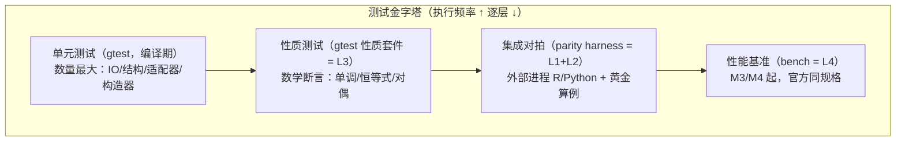
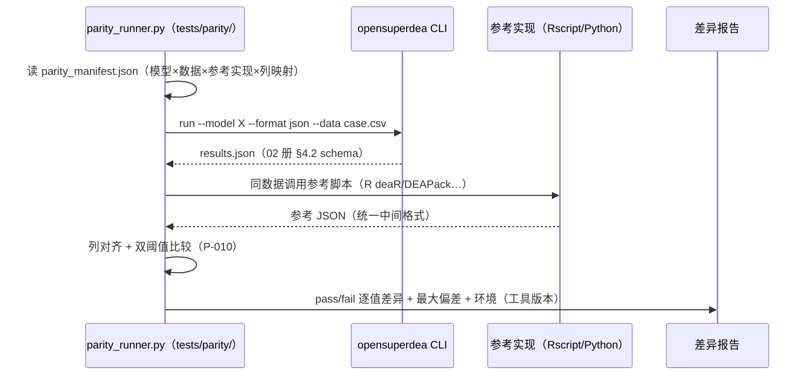

# 04 验证与测试计划（Verification & Test Plan）

> 版本：V1.0 ｜ 2026-10-24 ｜ 依据：SRS V1.0（FR-TST-001~006、NFR-PERF-001~006、NFR-MAINT-001、NFR-AVAIL-001/002）、启动提示词 §7 验证体系、DR-005/006
> 范围：M1-M5 全周期测试战略（M6 GUI 集成测试随其里程碑补充设计）。核心承诺：**每阶段功能实现必须经第三方开源工具（R 语言生态）对拍/复现验证，测试全绿才进下一阶段**（用户指令 + DR-005 阶段门禁）。

## 1. 测试金字塔与四层验证映射

| 层级 | 手段 | 触发 | 通过标准 |
|---|---|---|---|
| L1 开源对拍 | deaR/DEAPack/PyDEA/R productivity（外部进程） | 每模型合入 develop 前 | 双阈值容差（绝对 1e-6 或相对 1e-9，P-010）逐值通过 |
| L2 论文算例 | tests/golden/ 黄金算例库 | 同上 | 误差 < 1e-6（EBM ρ/ε < 1e-8） |
| L3 数学性质 | gtest 性质套件 | 同上 | 全部断言通过 |
| L4 性能基准 | bench/ 官方同规格 | M3/M4 门禁 + 里程碑回归 | NFR-PERF-003/004 达标 + 硬件记录（P-014） |

## 2. 对拍 harness 架构（FR-TST-001）

- **隔离**：harness 仅经 CLI 可执行 + 文件交互，不链接产品源码（NFR-SEC-001 许可边界：GPL 工具只对拍不移植）。
- **参考侧胶水**：`tests/parity/refimpl/` 下每工具一薄层调用脚本（deaR.R、deapack.py、productivity.R、pydea.py），输出统一中间 JSON；工具版本固定记录于 `refimpl/versions.lock`，升级必须全量回归。
- **清单驱动**：`parity_manifest.json` 声明 模型 × 算例 × 参考实现 × 列映射 与容差覆写（个别实现差异处显式标注理由）。

## 3. 黄金算例库（FR-TST-003 / FR-IO-008）

| 算例 | 数据规模 | 服务模型 | 期望值来源 | 里程碑 |
|---|---|---|---|---|
| 32 打印机（Doyle-Green 1991） | 32×(6in/3out?)（7 变量）+ 群组列 | Cluster 全套：E¹-E⁴ 分层 + attractiveness/progress + VJ + λ* | Seiford-Zhu 2003 Table 2-6（已精读落库） | M5 |
| Airlines 28 | 28 DMU | MinDS | deaR 内置 + Zhu 2018 | M5 |
| 32 机场（Vakili） | 32 DMU | WeakEF | 论文 PDF 数值表 | M5 |
| PISA 902 学校 | 902 DMU | MinDS 面向模型 | Aparicio-Cordero-Pastor（CORE 开放） | M5 |
| GRIPS EBM | 小例 | EBM ρ=1.471/ε=0.529 | GRIPS DP09-21 | M5 |
| Liang 2008 | 小例 | Nash 博弈交叉效率 | 论文数值表 | M5 |
| Sharp 2007 | 含负数据小例 | 修正 SBM | 论文数值表 | M5 |
| Kansas 农场 1990 | 小例 | AR | Thompson 1990 | M5 |
| Färe 1994 面板 | 面板 | Malmquist 基础 + HMB | 经典分解表 | M2/M5 |
| CCR 1978 / 经典小例 | 小例 | 径向族/对偶一致性 | 手算/文献 | M2 |
| toy_cross / toy_panel | 3-5 DMU | M1 IO 验收 | 手算 | M1 |

结构：`tests/golden/<case>/{data.csv, expected.csv, README.md(出处/DOI/容差/许可)}`；L2 断言直接按 02 册列集对齐，零转换。

## 4. L3 数学性质断言库（FR-TST-004）

| 性质 ID | 断言 | 服务模型 |
|---|---|---|
| PR-01 | 强单调：改进任一 DMU 目标值，MinDS 测度严格改进 | MinDS（FR-MIND-001） |
| PR-02 | A*(d) > 1 且随 d 递减 | Cluster（FR-CLU-004） |
| PR-03 | P*(g) > 1 且随 g 递增 | Cluster（FR-CLU-005） |
| PR-04 | 增删无效 DMU 改变 Cluster 效率；常规 DEA 不变 | Cluster 本质差异（FR-CLU-012） |
| PR-05 | Malmquist 分解恒等式（EC×TC=MI，含各参比变体） | TFP 族 |
| PR-06 | 乘子-包络强对偶相等（全数据集扫描） | FR-MULT-002 |
| PR-07 | 修正 SBM 平移不变 + 单位不变（数值检验） | FR-NRAD-006 |
| PR-08 | big-M 扰动不敏感性（M×/÷10 结果相对变化 < 1e-9 抽检） | NFR-PERF-005 |
| PR-09 | 并行与串行结果一致（DR-008 细化：效率值/状态/汇总排名 1e-9 容差逐值一致；LP 多重最优解下的顶点类输出——松弛/投影/乘子截距——不跨配置数值对齐，断言有限性与解自洽） | FR-PERF-001 |
| PR-10 | Nash 迭代收敛且满足均衡条件（ unilateral deviation 不改进） | FR-NASH-001 |

实现：gtest 套件 `tests/unit/<milestone>/property_test.cpp`，数据驱动的构造算例（程序内生成，不依赖外部文件）。

## 5. 各里程碑测试门禁定义（NFR-AVAIL-002）

| 里程碑 | 门禁组成（全绿才可申请用户验收） |
|---|---|
| M1 | 单元测试全绿（§M1 套件表）+ 双平台 CI 全绿 + 六任务验收证据 |
| M2 | M1 回归 + 每模型 L1 对拍（deaR/PyDEA）+ L2 算例 + 性质套件（PR-06 等）+ 覆盖率 ≥ 80% |
| M3 | M2 回归 + L4 十万基准实测报告（分钟级完成，实测数据入报告；达标判定移 M4，DR-008）+ PR-09 |
| M4 | M3 回归 + L4 百万基准（NFR-PERF-004）+ 十万达标判定（NFR-PERF-003 ≤ 30.4s，DR-008）+ PR-09 + 一致性抽检 |
| M5 | M2 回归 + 逐算法 L1/L2/L3（32 打印机全数值、GRIPS 1e-8、Liang 2008、Kansas、Airlines、PISA、Sharp）+ PR-01~10 |
| M6 | 引擎结果回归（GUI/CLI 同源一致）+ GUI 集成用例 |
| M7/M8 | 平台矩阵回归 + 许可审计（NFR-SEC-001/002）+ 性能报告汇总 |

阶段测试报告：`design_docs/reports/m<milestone>_test_report.md`（用例统计/通过率/L4 数据与硬件环境/遗留问题）。

## 6. 覆盖率与工具链

- 度量：llvm-cov（clang）或 gcovr（GCC），`OPENSUPERDEA_ENABLE_COVERAGE=ON` 预设；门禁范围 `src/core` + `src/adapters` 行覆盖 ≥ 80%（P-009），CLI 层 ≥ 60%（参考值）。
- 对拍工具安装与版本：阶段三统一预装（DR-005）；`refimpl/versions.lock` 记录精确版本，M2 首次对拍前校验。
- 测试数据纪律：黄金算例与期望值不得为迁就实现而修改；发现期望值疑问 → 记 tmp/ 待确认（C-06）。

## 7. 需求追溯

FR-TST-001~006 全条；NFR-PERF-001~006；NFR-MAINT-001；NFR-AVAIL-001/002；P-009/P-010/P-014 裁决落点；02 册 §5（算例 schema 对接）。
