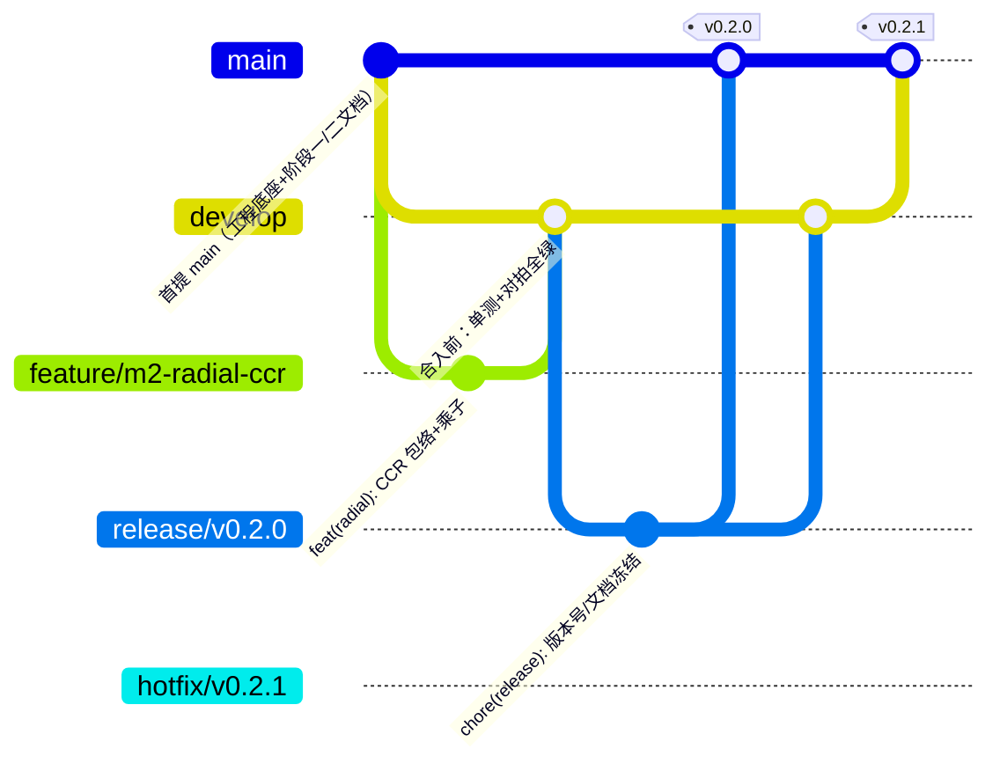
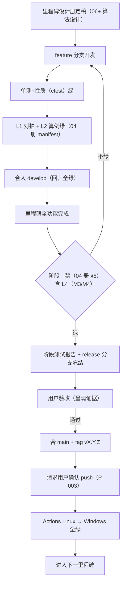

# 05 Git Flow 开发流程规范（Git Flow & Dev Process）

> 版本：V1.0 ｜ 2026-10-24 ｜ 依据：SRS V1.0（C-05/NFR-AVAIL-001/002、FR-ENG-007）、DR-005/006、启动提示词 §3 硬性约束
> 范围：分支模型、提交规范、阶段门禁流程、push 授权、版本与 tag 策略。对全部里程碑生效。

## 1. 分支模型（Git Flow）

| 分支 | 命名 | 用途 | 保护 |
|---|---|---|---|
| main | `main` | 稳定基线；仅接受 release/hotfix 合并与首提 | 每合并必 tag |
| develop | `develop` | 集成主线；feature 目标 | 合入前门禁全绿 |
| feature | `feature/<milestone>-<topic>`（如 `feature/m1-vcpkg-deps`） | 单功能开发 | 一功能一分支一 PR 级合并 |
| release | `release/vX.Y.Z` | 里程碑收尾冻结（版本号/文档/回归） | 只修不增 |
| hotfix | `hotfix/vX.Y.Z` | 线上缺陷修复（自 main 切出） | 回合 main+develop |

简化规则：M1 无并行开发，允许 develop 直并 main 出 v0.1.0（省略 release 分支，03 册 §7）；M2 起一律走 release 分支。

## 2. 提交规范（Conventional Commits）

- 格式：`<type>(<scope>): <subject>`；type ∈ feat/fix/docs/refactor/test/build/ci/chore/perf；scope 取模块名（radial/nonradial/distance/cross/cluster/tfp/dataset/cli/adapters/build/ci/docs）。
- 正文（可选）说明动机与影响；**需求/决策关联**：催生 DR 的改动在正文末尾加 `Decision: DR-XXX`（全局决策约定）。
- 示例：`feat(cluster): 分层剥离算法（Seiford-Zhu 模型1）`、`test(tfp): FR-TFP-003 global malmquist 对拍用例`。
- 机器强制：pre-commit 钩子（clang-format/clang-tidy/@file 检查，DR-002）不过即阻断；adapters/ 路径豁免命名检查（DR-004）。

## 3. 阶段门禁流程（瀑布·阶段门禁，DR-005）

- 门禁证据链：ctest 输出 + parity 差异报告 + 覆盖率报告 + （M3/M4）基准报告（含硬件，P-014）。
- 验收失败或门禁不绿：回 feature 分支修复，不得绕过（NFR-AVAIL-002）。

## 4. push 授权与 CI 触发（C-05、P-003 裁决）

- 默认**禁止 push**；本地提交自由。
- 授权时点：**每里程碑收尾一次性确认**（release 冻结后、tag 前）——一次授权覆盖该次 release 全部分支推送（develop/release/main/tag），触发 Actions Linux→Windows。
- 日常 feature 分支不推送；如确需中途验证 CI（如 Windows 兼容性问题排查），单独请示。

## 5. 版本号与 tag 策略

| 里程碑 | 版本 | 说明 |
|---|---|---|
| M1 | v0.1.0 | 工程底座（A-005 映射） |
| M2 | v0.2.0 | 常规引擎 |
| M3 / M4 | v0.3.0 / v0.4.0 | 性能 / 极速 |
| M5 | v0.5.0 | 独有算法全量（CLI 功能完备） |
| M6 | v0.6.0 | GUI |
| M7 | v0.7.0 | 平台扩展 |
| M8 | **v1.0.0** | 正式发布 |

- 语义化：里程碑递增 MINOR；hotfix 递增 PATCH；1.0 前不承诺 API 稳定。
- 版本号单一事实源：CMake `project(OpenSuperDEA VERSION X.Y.Z)`，`version` 子命令与 tag 从此读取（FR-CLI-001）。

## 6. 决策记录与需求变更挂钩

- 里程碑内重大技术决策 → docs/decision_log.md（DR-XXX，编号递增），提交带 `Decision: DR-XXX`。
- SRS V1.0 后需求变更：书面申请 → 影响评估 → 用户确认 → SRS 递增版本（V1.1…）+ 追踪矩阵更新（SRS 附录 8.3 约定）。
- 里程碑收尾：更新 docs/project_context.md（进度/新知识固化）。

## 7. 首条提交内容清单（M1 任务 1 执行口径）

工程文件（README/AGENTS/naming_convention/.clang-*/.editorconfig/.gitattributes/.gitignore/.vscode/CMakeLists/src/scripts）+ docs/（含 DR-005/006）+ research_docs/ + design_docs/（00-05 全部 + 本册）；**不含** build/、tmp/、.zcode/（.gitignore 已覆盖）。

## 8. 需求追溯

C-05（push 纪律）、FR-ENG-006/007（CI 与钩子）、NFR-AVAIL-001/002（三段式与门禁）、P-003 裁决落点、A-005 版本映射定稿。
