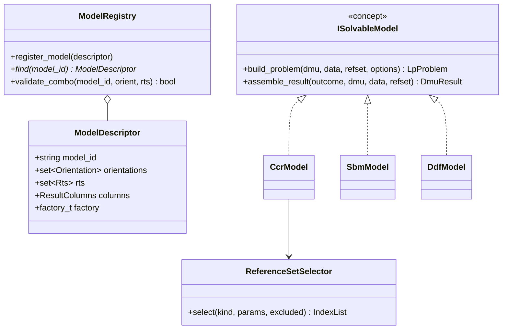
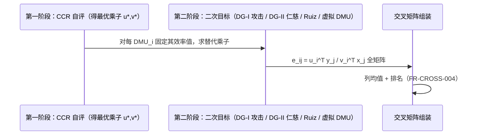
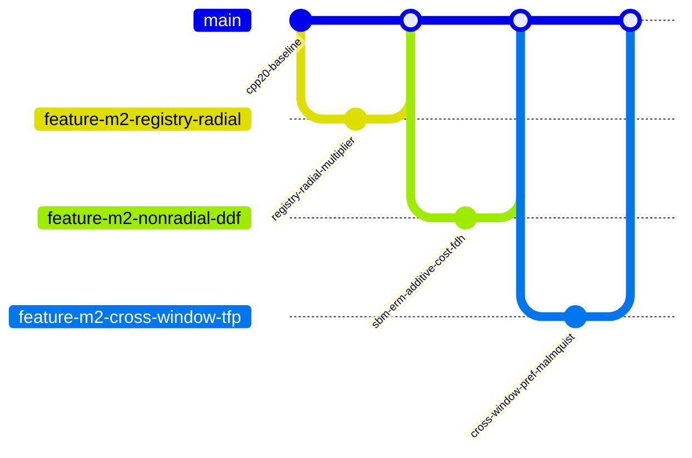

# 06 M2 常规引擎详细设计（M2 Engine Design）

> 版本：V1.0 ｜ 2026-10-24 ｜ 依据：SRS V1.1（C-01：C++20，DR-007）、01 总体设计、02 数据设计、04 验证测试计划
> 范围：M2 全部交付的算法详细设计——模型注册表与参考集选择器落地、径向族/非径向族/方向距离/成本收益/FDH/乘子/交叉效率/窗口/偏好/相邻 Malmquist 的 LP 构造、结果导出、对拍 harness 首批接线。
> 数学约定：矩阵 X（n×m 投入）、Y（n×s 产出）；被评 DMU 下标 0；λ 强度权重；全部 LP 经 highs_adapter（M1 交付）。

## 1. 模型注册表落地（C++20 concepts，DR-007 核心收益）



- `ISolvableModel` 为 C++20 concept（非虚继承）：`template <class M> concept SolvableModel = requires(M m, const SolveContext& c) { { m.build_problem(c) } -> std::same_as<solver::LpProblem>; { m.assemble_result(c, std::declval<solver::SolveOutcome&>()) } -> std::same_as<DmuResult>; };` 注册表存工厂 lambda（捕获具体类型），**无虚函数开销、接口遗漏编译期报错**。
- `SolveContext`：一次性装配 {Dataset、被评 DMU 索引、ReferenceSet 已选索引、SolveOptions}，模型只读。
- 能力矩阵即注册表数据（FR-CLI-008）：`validate_combo` 直接查 descriptor 集合，CLI/GUI 共用。
- M1 占位 `model_id_known` 白名单删除，`run` 子命令改为：查注册表 → 逐 DMU 构造-求解-组装 → 结果导出。

## 2. 参考集选择器实现（01 册 §4.2 落地）

| kind | 规则 | 消费方（本册/M5） |
|---|---|---|
| `all` | 全体 DMU | 常规模型默认 |
| `exclude_self` | 全体 − 被评 DMU | 超效率族 |
| `window(t, w)` | 期次 [t-w+1, t] 合并截面 | 窗口分析/Window Malmquist（M5） |
| `layer(l)` / `group(g)` / `fixed(T*)` / `period_pair(t,s)` | 分层/群组/固定/跨期 | M5（Cluster/TFP）本册只留接口 |

选择器返回 `IndexList`（进入约束的 DMU 行索引），模型侧只对索引集构造矩阵切片（Eigen 行子集）。

## 3. 径向族 LP 构造（FR-RAD-001~005）

### 3.1 输入导向包络（CCR：无 Σλ 约束；BCC/NIRS/NDRS 加截距约束）

```text
min θ
s.t.  X_ref^T λ ≤ θ · x0        （投入收缩）
      Y_ref^T λ ≥ y0            （产出不降）
      Σλ = 1 (VRS) | Σλ ≤ 1 (NIRS) | Σλ ≥ 1 (NDRS) | 无 (CRS)
      θ 自由, λ ≥ 0
```

- 变量：θ + |ref| 个 λ；效率值 = θ*；slack 从对偶解/二阶段提取（FR-OUT-004）。
- 输出导向对偶镜像（max φ, Yλ ≥ φy0, Xλ ≤ x0）。
- 投影：x_target = θ*x0 − s⁻，y_target = y0 + s⁺（FR-OUT-002）。

### 3.2 超效率（FR-RAD-005）

参考集 `exclude_self`；VRS 超效率不可行时结果标注 `infeasible`（02 册状态枚举），不输出数值。

### 3.3 规模效率分解（FR-RAD-004）

同 DMU 解 CRS 与 VRS 两次：TE = θ*_CRS，PTE = θ*_VRS，SE = TE/PTE；NIRS 求解判别规模报酬区间（SE<1 且 θ_NIRS>θ_VRS → IRS；θ_NIRS=θ_VRS → DRS）。L3 断言 TE = PTE × SE（恒等式，浮点容差内）。

### 3.4 乘子模型（FR-MULT-001/002）

包络的对偶形式直接实现（非解包络取对偶）：CCR-I 乘子形式 `max u^T y0 s.t. v^T x0 = 1, u^T Y − v^T X ≤ 0, u,v ≥ 0`；输出乘子/投入乘子进 FR-OUT-005。L3：乘子最优值 = 包络最优值（PR-06，逐 DMU 断言）。

## 4. 非径向族（FR-NRAD-001~004）

### 4.1 SBM（Tone 2001）

分式 → Charnes-Cooper 变换为 LP：

```text
min ρ = (1 − (1/m)Σ s⁻/x0) / (1 + (1/s)Σ s⁺/y0)
→ min t − (1/m)Σ S⁻_i/x0_i   （t>0 缩放变量）
s.t. X_ref^T λ + S⁻ = t·x0；Y_ref^T λ − S⁺ = t·y0
     t + (1/s)Σ S⁺_j/y0_j = 1；λ, S⁻, S⁺ ≥ 0（VRS 加 Σλ=1）
```

定向变体：投入型只含 s⁻ 项、产出型只含 s⁺ 项（MaxDEA 口径，对拍确认）。

### 4.2 SBM 超效率（Tone 2002）

exclude_self 参考集 + 同变换；不可行处理同径向。

### 4.3 ERM（增强 Russell 测度）

投入与产出的 Russell 图形测度 LP 形式（径向比例+松弛的平均结构），与 SBM 共享变换骨架，注册为独立模型；与 SBM 数值关系在代码注释说明（01 调研：两者并列的最大距离度量）。

### 4.4 加权加性族 9 种子模型（P-006 核定，基于本地调研推断，实现期与 MaxDEA 功能存档核对）

| # | 子模型 | 出处 | 备注 |
|---|---|---|---|
| 1 | ADD 简单加性 | Charnes-Cooper 等 | Σ(s⁻/x̄ + s⁺/ȳ) 无界范数 |
| 2 | 归一化加权加性 | Lovell-Pastor 1995 | 以均值归一 |
| 3 | RAM | Cooper-Pastor-Tone 1997 | 范围调整 |
| 4 | BAM | Cooper-Pastor-Tone 1999（有界调整） | 上下界参数化 |
| 5 | DSBM | 方向 SBM（Tone） | 给定方向的比例+松弛 |
| 6-8 | 加权 SBM（投入加权/产出加权/非导向） | Tone 2001 §加权扩展 | w 权重向量 |
| 9 |广义加权加性（wADD，Lovell-Pastor 一般权） | 综述口径 | 与 2 的差异在归一化基 |

> 标注：#4-#9 的精确对应以实现期本地 MaxDEA 功能文档核对为准（P-006 裁决：不上网调研）；对拍以可对照开源项逐模型确认（04 册 L1 矩阵），不可对照项以 L2 构造算例 + L3 性质兜底。

## 5. 方向距离族（FR-DDF-001~003）

```text
max β s.t. X_ref λ ≤ x0 − β·g_x；Y_ref λ ≥ y0 + β·g_y；λ ≥ 0（+RTS 约束）
```

- 内置方向：g=(x0, y0)（自身）/ (x̄, ȳ)（均值）/ 单位向量；
- 自定义：Dataset.directions 逐 DMU 提供（FR-IO-002 已就绪）；
- RDM：方向取观测范围（max−min 归一），作为内置方向选项之一实现（非独立模型）。

## 6. 成本/收益/利润（FR-COST-001~003，价格列 pi_/po_ 消费）

- 成本效率 = w^T x0 / w^T x*，x* 由成本最小化 LP（min w^T x s.t. 技术可行）求得；配置/技术分解输出。
- 收益效率镜像；利润效率 = (p^T y0 − w^T x0)/(p^T y − w^T x) 最优化（可为负，处理见算例）。
- V-008/V-010 规则（价格非负/权重和）随本批启用。

## 7. FDH（FR-FDH-001，MILP）

λ 改 0-1 整数变量（HiGHS integrality），约束同径向去掉凸性假设；in/out/non 三定向。

## 8. 交叉效率（FR-CROSS-001~004）



- 第二阶段约束：保持 e_ii 不变 + 乘子归一（v^T x_i = 1），目标按类型（攻击：min Σ_{j≠i} e_ij；仁慈：max）；
- Ruiz 两类与自定义虚拟 DMU（乘子向量输入）为第二阶段目标/约束变体，同一骨架参数化。

## 9. 窗口分析（FR-WIN-001）与偏好模型（FR-NEG-001）

- 窗口：对每窗口起点的参考集 `window(t,w)` 跑底层模型（径向/SBM 可选），输出 DMU×期次矩阵；
- 偏好固定权重：乘子模型权重固定为用户输入（w_in_/w_out_ 列），效率 = 固定乘子下被评 DMU 比值。

## 10. 相邻 Malmquist（FR-TFP-001，距离函数内核）

```text
MI(t, t+1) = √[ d^t(x_{t+1}, y_{t+1}) / d^t(x_t, y_t) × d^{t+1}(x_{t+1}, y_{t+1}) / d^{t+1}(x_t, y_t) ]
EC = d^{t+1}(x_{t+1}, y_{t+1}) / d^t(x_t, y_t)；TC = MI / EC
```

- 内核：`distance(dmu_pair, tech_period, orientation, rts)` —— 4 次距离求解/DMU 对；M5 的 7 参比只换技术集定义（参考集选择器），内核不动；
- 不平衡面板：相邻期交集缺失的 DMU 跳过并记录（02 册 §2.3）。

## 11. 结果导出（FR-OUT-001~006 + FR-IO-006/007）

- 列集由 ModelDescriptor.columns 声明（01 册 §4.1）；CSV 默认 / JSON 可选（--format，P-011）；
- meta 含 data_sha1（02 册 §4.2）——对拍 harness 同源判定；
- 排名/汇总（FR-OUT-006）随结果对象一次生成。

## 12. 对拍 harness 首批接线（FR-TST-001/002）与黄金算例库（FR-IO-008）

- `tests/parity/`：parity_runner.py + refimpl/{deaR.R, pydea.py}；M2 批 manifest：CCR/BCC/SBM/超效率/窗口 × toy_cross + CCR1978 经典算例；
- `refimpl/versions.lock` 固化 R 包版本（deaR 1.5.4 / productivity 1.1.2，本机已装）；
- L2 黄金算例 M2 批：CCR 1978 经典小例 + Färe 1994 面板（Malmquist 基础）；
- L3 断言：PR-05（Malmquist 恒等式）、PR-06（乘子-包络对偶）随套件交付。

## 13. M2 测试与门禁（04 册 §5 M2 行）

- 单元：每模型 ≥1 手算小例（4-6 DMU）+ 对拍用例；验证 V-008/V-010 新规则；
- 覆盖率门禁启动：`OPENSUPERDEA_ENABLE_COVERAGE=ON`，core+adapters 行覆盖 ≥ 80%（P-009）；
- 门禁顺序：ctest 全绿 → L1 对拍全绿 → L2 算例 → L3 性质 → 覆盖率报告 → 用户验收。

## 14. M2 开发切分（Git Flow，3 个 feature 分支）



- 分支 1 即切 C++20 已就位（本册前置完成）；每分支合入前 ctest + 对拍全绿；
- 收尾：release/v0.2.0 冻结 → 阶段测试报告 → 用户验收 → tag → push 授权。

## 15. 需求追溯

FR-RAD-001~005、FR-NRAD-001~004、FR-DDF-001~003、FR-COST-001~003、FR-FDH-001、FR-MULT-001~002、FR-CROSS-001~004、FR-WIN-001、FR-NEG-001、FR-TFP-001、FR-OUT-001~006、FR-IO-003/006/007/008、FR-TST-001/002/003/004/006；P-006（§4.4）、P-009（§13）、P-011（§11）落点。
