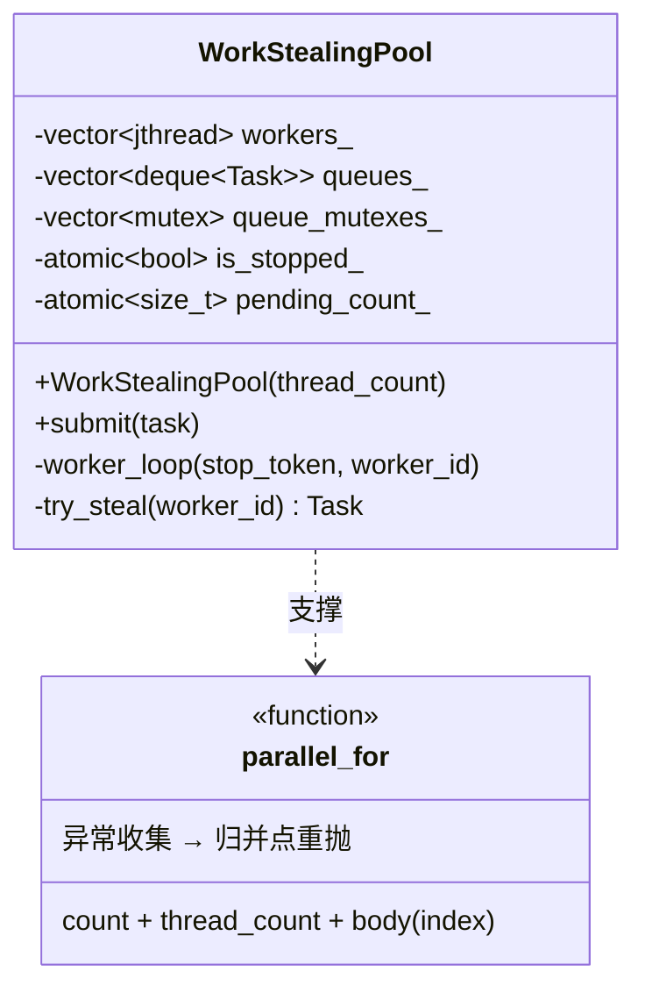
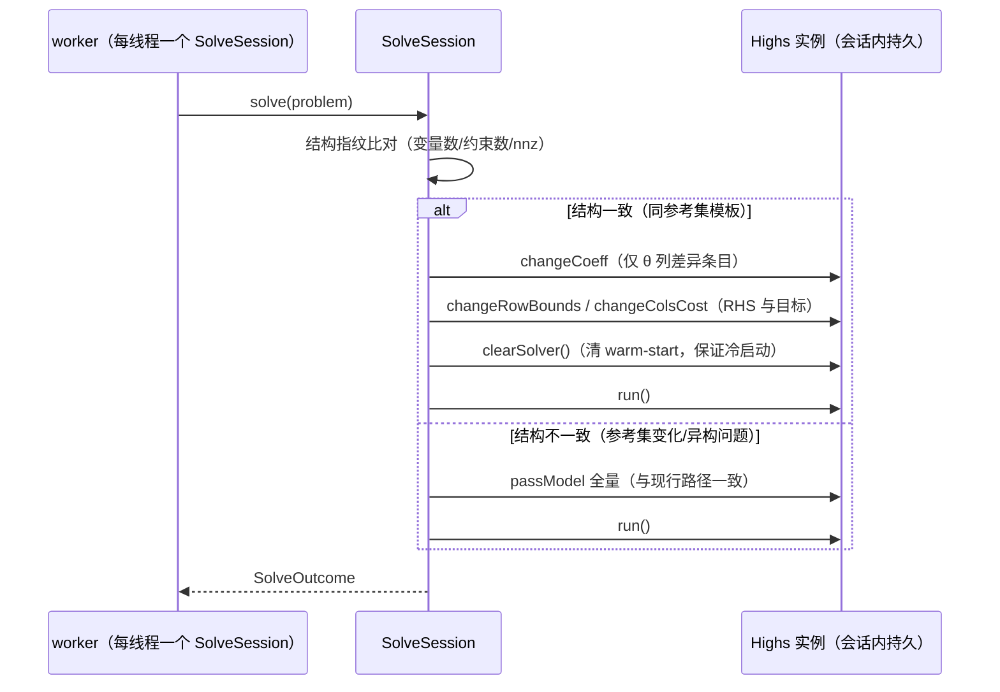

# 07 M3 性能优化详细设计（M3 Performance Design）

> 版本：V1.2 ｜ 2026-10-25 ｜ 依据：SRS V1.2 §3.21/§4.1/§8.2、01 总体设计 §4.4、04 验证计划 §4/§5、M2 引擎现状（06 册交付物与代码实测）
> V1.1 变更：§4 数据集策略按用户裁决更新（对数正态 + 强有效比例控制、10 组统计口径对齐官方、datasets/ 独立目录并提前备齐 M3-M5 全部数据资产）。
> V1.2 变更（DR-008）：§3.2 求解语义由「clearSolver 冷启动」改为「基复用热启动（可回退）」；§5 PR-09 口径细化；§3.1 新增 presolve off 实测依据；NFR-PERF-003 达标判定移 M4。
> V1.2 实测修正（F-007）：热启动在同构序列成立（探针 9×），但引擎全流程一/二阶段结构交替使基复用零生效，10 万全流程实测 5h08m（presolve off 贡献 1.8×）；「结构稳定化」列为 M4 第一优先优化。
> 范围：M3 全部交付的性能设计——FR-PERF-001（DMU 级并行求解框架）、FR-PERF-004（稀疏存储与分块构造）、FR-PERF-005（bench 基准 harness）。
> 核心原则：数值语义不变（01 册 §4.4「两个正交开关，不改变数值语义」）——PR-09（并行与串行结果逐值一致，1e-9 级，04 册 §4）为 M3 固定门禁；达标线 NFR-PERF-003：10 万 DMU 3×3 BCC ≤ 30.4s（官方 25.32s × 1.2，P-002）。

## 1. 现状与瓶颈分析（M2 代码实测）

M2 求解路径（全部模型统一）：

```text
run_model 主循环（model_runner.cpp:111-124，串行 for）
  └─ 每 DMU：SolveContext 装配 → descriptor->solve(context)
       └─ make_solve_function 管线（solvable_model.h:55-63）
            build_problem → LpProblem（稀疏三元组裸 push）
            adapters::solve_lp（highs_adapter.cpp:118-148）
              ├─ build_rowwise_matrix（:24-56）：map<row> + 每行 sort 重聚合，O(nnz·log nnz)
              ├─ Highs 栈实例新建（:121）+ output_flag=false + random_seed=0
              └─ passModel（全矩阵拷贝）→ run()（内层默认单线程）
```

另有三条专用逐 DMU 循环：交叉效率 stage1/stage2（`cross_efficiency.cpp:57-79, 353-381`，stage2 消费 stage1 效率值）、窗口分析（`window_analysis.cpp:82-99`）、相邻 Malmquist（`malmquist.cpp:138-223`，每 DMU 期对 4 次距离 LP）。

10 万 DMU 3×3 BCC（输入导向包络）的单 LP 画像：

| 项 | 规模 | 说明 |
|---|---|---|
| 变量数 | n + 1 ≈ 100,001 | λ × n + θ |
| 约束数 | m + s + 1 = 7 | 投入 3 + 产出 3 + Σλ=1 |
| 非零元 nnz | ≈ 6n + 7 ≈ 60 万 | λ 列各 6 个非零 |
| 矩阵 CSR 体量 | ≈ 5 MB/次 | 10 万次 = ~500 GB 内存写入流量 |
| 各 DMU 差异 | 仅 θ 列系数（≤6 条）+ 行界 RHS + 目标 | λ 部分系数矩阵完全相同 |

串行瓶颈按代价排序：① 每 LP 的 passModel 全矩阵拷贝（~500 GB 累计流量）；② 每 LP 的 map+sort 重聚合（O(nnz·log nnz) 且 map 节点堆分配密集）；③ 10 万次 LP 串行执行无并行度；④ HiGHS 实例每次新建（次要）。M2 报告无任何性能实测记录（仅 `ResultMeta.elapsed_ms` 字段），阶段 3 bench 先行补基线。

## 2. 并行调度框架（FR-PERF-001）

### 2.1 线程池选型（「先找轮子」轻量预研，链接已实测可达）

| 候选 | 许可证 | Star | 调度模型 | C++ 基线 | vcpkg 端口 | 评估 |
|---|---|---|---|---|---|---|
| [bshoshany/thread-pool（BS::thread_pool）](https://github.com/bshoshany/thread-pool) | MIT | ~3.1k | 中心任务队列 | C++17 | bshoshany-thread-pool | 成熟稳定，但为中心队列模型，与 SRS 点名的「工作窃取队列」不符；异常经 future 传播，需适配层 |
| [taskflow/taskflow](https://github.com/taskflow/taskflow) | MIT | ~12.2k | DAG 任务图 + work-stealing executor | C++20（GCC≥11/MSVC≥19.29） | taskflow | 功能远超需求（DAG/条件/流水线/异步），为「10 万个同质独立小任务」引入整套任务图抽象不值，头文件体量大 |
| [DeveloperPaul123/thread-pool（dp）](https://github.com/DeveloperPaul123/thread-pool) | MIT | ~570 | 中心队列 | C++20 | dp-thread-pool | 轻量 header-only，但同样无工作窃取，社区规模与提交历史较小 |

**结论：自研** `work_stealing_pool`（预估 ~200 行）。理由：SRS FR-PERF-001 处理逻辑明确「任务划分（每 DMU 一个 LP）→ 工作窃取队列 → 结果归并」，需求语义（同质独立任务 + 异常收集 + 归并点重抛 + 与串行 bit 级一致）非常具体，自研最可控、零新依赖（不动 vcpkg 清单，规避引入依赖的评审成本），且便于 PR-09 直接覆盖。若实施中发现自研成本失控，回退次选 BS::thread_pool（接受中心队列或包一层适配），届时走 DR 流程记录。

### 2.2 工作窃取线程池设计



- 新文件 `src/core/parallel/work_stealing_pool.{h,cpp}`：`WorkStealingPool`（C++20 `std::jthread` + `std::stop_token`，DR-007 点名的前置收益）；worker 持本地 deque（`std::mutex` 保护——任务粒度为毫秒级 LP，锁竞争可忽略，不引入无锁结构复杂度），本地空时从其他 worker 队列头窃取。
- 顶层便捷接口（同头文件）：`parallel_for(count, thread_count, body)`：把 `[0, count)` 划为块（块大小 = `max(1, count / (thread_count * 16))`，保尾部均衡）submit，主线程参与等待；完成后返回。
- **线程安全前提已核实**：`SolveContext` 全只读（`solvable_model.h:24-30`）；`SolveFunction` 工厂 lambda 无捕获、每次调用构造局部模型实例（`solvable_model.h:57-62`）；结果预分配 `std::vector<DmuResult> results(n)` 按 `dmu_index` 无锁写入；`summarize`（`model_runner.cpp:21-70`）在归并后串行执行——排名、均值（`std::accumulate` 顺序）、中位数与串行路径完全一致。
- 池生命周期：每次 `run_model` / 专用流水线运行时按需创建、结束时析构（8 线程池创建 ~百微秒级，相对 30 s 总时长可忽略），无进程级全局状态。

### 2.3 四处循环的并行化改造

| 循环 | 落点 | 并行策略 |
|---|---|---|
| run_model 主循环 | `model_runner.cpp:111-124` | 整体 `parallel_for(n, threads, ...)`；`context.options.model_options["super"]` 的装配移入任务体（每任务独立拷贝） |
| 交叉效率 | `cross_efficiency.cpp:57-79, 353-381` | stage1、stage2 分两段各自 `parallel_for`，段间隐式同步（stage2 读 stage1 全部效率值）；交叉矩阵组装与列均值/排名保持归并后串行 |
| 窗口分析 | `window_analysis.cpp:82-99` | (窗口 × 单元) 展开为任务列表并行；`dmu_index` 由累计 `size()` 隐式赋值（:96）改为显式索引计算 |
| 相邻 Malmquist | `malmquist.cpp:138-223` | 期对串行（数量少）、期内 DMU 循环 `parallel_for`（每 DMU 的 4 次 `distance_value` 在任务内串行）；`dmu_index`（:209）同样改显式 |

窗口/Malmquist 内联复制的汇总统计逻辑本册不改（重构非 M3 目标），仅保证其在归并点之后按原顺序执行。

### 2.4 异常与取消语义

- 任务体内异常 → worker 捕获后存入 `std::exception_ptr`（`std::atomic` 比较交换仅保留首个），置停止标志，未启动任务快速跳过；
- `parallel_for` 在全部 worker 汇合后**重抛首个异常**（`EngineException` 的 EXIT_ARG/EXIT_SOLVE 语义不变）；无异常时正常返回。
- `--threads 1` 时 `parallel_for` 直接退化为串行 for 循环（不创建池、不引入任何调度开销），作为 PR-09 的对照路径与保守回退开关。

### 2.5 并行度配置

- `RunConfig`（`model_runner.h:20-25`）增加字段 `unsigned int thread_count = 0;`——运行级元信息，不进入模型 LP（与 `SolveOptions` 分离，模型无感知）。
- `thread_count = 0`：auto = `std::thread::hardware_concurrency()`（返回 0 或 1 时取 1）；`thread_count = 1`：强制串行路径；`≥ 2`：创建对应线程数的池。
- CLI `run` 子命令增加 `--threads N`（默认 0=auto），进 `--help` 能力说明；本机 8 核 31GiB 为加速比参考环境（P-014 记录实际值）。
- CMake：根 `CMakeLists.txt` `find_package(Threads REQUIRED)`，`opensuperdea_core` 链接 `PUBLIC Threads::Threads`（GCC 需 `-pthread`；MSVC 下无副作用）。

## 3. 稀疏与分块（FR-PERF-004）

两个正交开关（01 册 §4.4）：§2 并行调度 + 本节稀疏分块，可独立启停。本节全部改造以「传入 HiGHS 的矩阵与求解起点逐项相同」为硬约束。

### 3.1 O(nnz) 有序快速路径（替代 map+sort 重聚合）

- 现状 `build_rowwise_matrix`（`highs_adapter.cpp:24-56`）对每个 LP 做 `std::map` 分桶 + 每行 `std::sort`，map 节点堆分配密集。
- 模型构造侧的 push 顺序天然按行组织（如 `radial_envelope_model.cpp:116-120` 逐约束行 push，行内按参考集索引递增）——新增快速路径：单遍扫描三元组，行内 ≤ 每行常数条目时用插入排序，输出与原路径**完全相同的 CSR**（行升序、行内列升序、重复条目行为一致）。
- 实现为 `highs_adapter.cpp` 内部双路径：输入已按 (row, column) 非降序 → O(nnz) 填充；否则回退原 map+sort 路径（正确性兜底）。快速路径的有序性由 debug 断言 + 单测锁定。此项无接口变化，`adapters/` 豁免区内改动（DR-004）。

### 3.2 HiGHS 实例复用与增量修改（消 passModel 全量拷贝）

- 问题结构：同参考集下各 DMU 的 LP 仅 θ 列系数（≤ 每行 1 条）、行界 RHS、目标系数不同，λ 部分系数矩阵逐项相同（§1 画像）。
- 新增 `adapters::SolveSession`（`highs_adapter.h` 声明、`highs_adapter.cpp` pimpl 实现，对外零 HiGHS 类型暴露，延续本目录隔离哲学）：



- **数值语义论证**：差异条目比对为 O(nnz) 只读比较（无分配，成本远低于 5 MB 写拷贝）；修改后的矩阵内容与全量 passModel 逐项相同。DR-008（F-006 实测热启动 7.8×）：模型未被探测篡改时**保留最优基**——HiGHS 对偶单纯形 warm start 直接再求解（同 worker 内逐 DMU 序列的基高度相似），探测篡改（model_dirty）才 clearSolver 冷启动；presolve off + solver=simplex 固定（窄矩阵 presolve 实测 5.3× 纯负担，且内点路径丢失基）。LP 最优目标值唯一（实测 100/100 DMU bit 级一致），顶点类输出（松弛/投影/乘子截距）在多重最优解下不跨配置对齐（PR-09 口径随之细化）。差异条目比例超过阈值（如 5%）时直接回退 passModel 全量路径。
- **bit 级一致专项单测**（阶段 2 门禁）：同一 LP 分别走「新建实例全量」与「会话增量」双路径，断言 `primal_solution`、`objective_value` 严格相等（`==`，非容差）；若 HiGHS 存在隐藏会话状态导致不一致，回退全量路径并在 m3 测试报告 §3 记录设计偏差（行为退化不阻塞交付）。
- 会话生命周期：`parallel_for` 任务体内使用 worker 本地会话（任务块内连续复用），不跨运行持久；MILP（FDH）同接口支持。
- 适用条件：参考集 `ALL` 的常规模型（含超效率的 `EXCLUDE_SELF`——同 n−1 规模亦稳定复用）；窗口/Malmquist 参考集逐窗变化 → 结构指纹不一致时自然回退全量路径，正确性不受影响。

### 3.3 内存峰值预算与监控口径

10 万 DMU 3×3 预算（8 线程）：Dataset ~5 MB + 8 × 会话（Highs 实例 + 模型 ~5 MB）≈ 40 MB + 结果数组（10 万 × DmuResult）数十 MB + 任务块临时 LP——峰值预期 < 500 MB，远低于 NFR-PERF-004 的 32 GB 线（该线为 M4 百万级）。M3 的内存工作 = bench harness 采集 RSS 峰值并入库报告（FR-PERF-004 验证手段），无专项压缩需求；`SolveSession` 复用本身即消除了「每 LP 重建 5 MB CSR」的分配峰值来源。

## 4. 数据集资产与 bench 基准 harness（FR-PERF-005）

### 4.1 数据集目录（M3 bench / M4 百万级 / M5 算法对拍共用，已按用户裁决提前备齐）

```text
datasets/
├── README.md              # 清单：来源 URL、许可证/引用、访问日期、用途映射（里程碑 × 模型）
├── generated/             # 程序生成的大规模随机算例（生成器入库，CSV 不入库）
│   ├── gen_bench_data.py
│   └── .gitignore
└── external/              # 外部获取的论文算例 / R 包导出数据（小文件入库）
    ├── *.csv
    └── papers/            # 关键论文 PDF 存档（内部对拍资产，不随 release 再分发）
```

### 4.2 生成算例（对数正态 + 强有效比例控制，官方口径对齐）

- **生成机制**（DEA 模拟文献标准做法，用户裁决 V1.1）：投入 `x_i ~ LogNormal(μ, σ)` → 产出经真实前沿函数生成 `y = f(x)·exp(-u)`（u 为右偏技术无效项）→ **强有效比例控制**：目标比例 P% 的单元 u=0（落于前沿，生成后经 CCR 校准实测比例，偏差记录入 datasets/README.md）；固定 seed 完全可复现。
- **统计口径对齐官方**（已核实 [SpeedCompare](https://maxdea.com/SpeedCompare_CN.htm)：随机数据 × 10 组取均值 + min-max 区间，硬件 i9-9900K 固频 3.6GHz）：每规格生成 10 组不同 seed，NFR-PERF-003 判定与加速比报告取 10 组均值并附区间。
- **规格矩阵对齐官方**：DMU ∈ {1 万, 10 万, 100 万} × 投入产出 ∈ {3×3, 5×5}；M3 门禁主用 10 万 × 3×3 BCC，1 万组供 NFR-PERF-006 参考，100 万组供 M4（NFR-PERF-004）。CSV 按 02 册 schema（`dmu,in_*,out_*`），生成后经 V-001~V-010 与 CLI 实跑校验。
- 生成器 Python 标准库实现（项目已有 Python3 工具链，零新依赖；R 生成器等价，取部署面更广者）。

### 4.3 外部数据集（M5 十项算法对拍基准，来源经 research_docs/unique_algorithms_survey.md 锁定）

| 数据集 | 来源 | 用途（M5） |
|---|---|---|
| Airlines 28 | deaR 1.5.4 内置（本机导出） | MinDS 对拍（deaR `model_addmin`） |
| 32 打印机（Doyle-Green 1991） | Seiford & Zhu 2003 论文数值表 | Cluster 黄金对拍（E¹-E⁴ 分层 + Table 3-6） |
| EBM 算例 | GRIPS DP09-21 PDF（ρ=1.471、ε=0.529） | EBM 复现（NFR-PERF-002） |
| 30 欧洲机场 | Vakili 等论文 PDF | WeakEF 对拍 |
| Kansas farming / banks | Thompson 1990 / Charnes 1990 论文 | AR/Cone 对拍 |
| 负数据算例 | Sharp 2007 / Lin 2019 论文 | 修正 SBM 对拍 |
| 奥运奖牌 | Wu 2009（OMEGA） | Nash 博弈交叉效率 |
| productivity 示例面板 | R productivity 1.1.2 内置（本机导出） | HMB/Malmquist 多参比对拍 |

数值表提取为 CSV 入 `external/`；论文 PDF 下载存档入 `external/papers/`（版权作品：内部对拍用，README 标注题录，不随 release 再分发）；提取状态与可达性在 datasets/README.md 逐条记录，不可达项不阻塞（M5 实现期补）。

### 4.4 bench harness

```text
bench/
├── README.md            # 用法与口径说明
└── run_bench.sh         # 计时 + 内存 + 硬件采集，产出 markdown 结果表
```

- **采集**（P-014）：`lscpu`（型号/核数/频率）+ `free -h` + `uname -a` 前置记录；每次运行 `/usr/bin/time -v` 取 wall clock 与 RSS 峰值。
- **执行矩阵**：消费 `datasets/generated/` 算例——10 万 × 3×3 BCC（NFR-PERF-003 官方同规格）× 10 组 × `--threads 1/2/4/8/auto`，输出「均值 (min-max)」格式的加速比表；另跑 CCR 与 1 万组作参考点（NFR-PERF-006）。
- **报告落点**：结果表贴入 `design_docs/reports/m3_test_report.md`（04 册 §5 证据链要求：ctest 输出 + parity 差异报告 + 覆盖率报告 + 基准报告含硬件）。

## 5. PR-09 验证设计（04 册 §4 落地）

- 新增 `tests/unit/m3/property_test.cpp`（04 册 §4 实现约定路径），新 gtest 目标 `opensuperdea_unit_tests_m3`（标签 `unit;m3`，对齐 M1/M2 组织方式）：
  - 程序内生成构造算例（500 DMU × 3×3，固定 seed，不依赖外部文件）；
  - 代表模型集全跑：bcc/ccr（径向）、sbm（非径向）、multiplier、ddf、cost（价格）、cross_efficiency、window、malmquist；
  - 每模型 `thread_count=1` 与 `thread_count=4`（CI runner 4 核安全）双跑，断言效率值/状态/汇总排名 1e-9 逐值一致；顶点类输出（松弛/投影/乘子截距——LP 多重最优解）断言有限性与规模一致，不跨配置数值对齐（DR-008 细化，04 册 §4 PR-09 行）；
  - `thread_count=auto` 冒烟一例（不比对耗时，仅验证可运行）；
  - 交叉效率 stage1→stage2 段间同步、窗口/Malmquist 显式索引各设针对性断言。
- 覆盖率维持：并行框架用线程数注入测试（异常路径、窃取路径、退化串行路径）覆盖，门禁 ≥80%（P-009）不变。

## 6. 测试与门禁计划（04 册 §5 M3 行）

门禁顺序：ctest 全绿（102 旧 + m3 新增，不缩减）→ L1 对拍 68/68（manifest 不得缩减）→ PR-09 全绿 → 覆盖率 ≥80% → L4 十万基准 ≤30.4s（P-014 硬件记录）→ 阶段测试报告 + release/v0.3.0 冻结 → 用户验收。三段式 CI（WSL 本地 → Actions Linux → Actions Windows）随 release 走全流程。

## 7. 开发切分（Git Flow，3 个 feature 分支）

```mermaid
gitGraph
   commit id: "develop@v0.2.0"
   branch feature/m3-parallel
   commit id: "work-stealing-pool + PR-09"
   checkout develop
   merge feature/m3-parallel
   branch feature/m3-sparse-memory
   commit id: "O(nnz) 聚合 + SolveSession"
   checkout develop
   merge feature/m3-sparse-memory
   branch feature/m3-bench-freeze
   commit id: "bench harness + release/v0.3.0"
   checkout develop
   merge feature/m3-bench-freeze
```

| 分支 | 内容 | 合入 develop 前门禁 |
|---|---|---|
| feature/m3-parallel | **前置：F-001 二阶段松弛 LP 数值稳健性修复**（M2 遗留缺陷：径向包络二阶段在 ≥~2000 DMU 概率性报 E3，CCR/BCC 皆触发；deaR/scipy 双仲裁数据无病态，10 万 BCC 串行基线 10m58s 失败中止——不修复则一切性能门禁无法进行，用户裁决排期为分支首个工作项）；§2 全部（池、四处循环、`--threads`、Threads 链接）+ §5 PR-09 测试 | ctest 全绿 + parity 68/68 + **10 万 DMU BCC 全量求解成功（F-001 修复验证）** + 手工加速比初测（复用 `elapsed_ms`） |
| feature/m3-sparse-memory | §3 全部（快速路径、SolveSession、bit 级一致专项单测） | ctest + parity 68/68 + PR-09 复跑 + 双路径严格相等单测 |
| feature/m3-bench-freeze | §4 bench harness + L4 基准报告 + 覆盖率复测 + release/v0.3.0 冻结 + m3 测试报告 | NFR-PERF-003 ≤30.4s + 覆盖率 ≥80% + 全量回归 + 三段式 CI |

版本号单一事实源 = 根 CMakeLists `project(... VERSION 0.3.0)`（05 册 §5）；收尾按 05 册 §3：release 冻结 → 用户验收 → 合 main + tag v0.3.0 → 一次性请求 push 授权（P-003）。

## 8. 风险与缓解

| # | 风险 | 缓解 |
|---|---|---|
| 1 | HiGHS 线程安全 | 每 worker 独立 `SolveSession`/实例，无共享可变状态；`output_flag=false` + `random_seed=0` 已关日志与随机路径；PR-09 多线程压测 + CI 双平台验证 |
| 2 | HiGHS 确定性（01 册 §4.4「固定线程内层」） | 并行仅在外层 DMU 级；显式 `threads=1`（默认 auto 启用全局执行器，多实例并发存在 dispose 竞争，TSAN 实证）+ presolve off + solver=simplex；热启动保留基（DR-008），探测篡改路径回退冷启动 |
| 3 | 增量路径数值分歧 | §3.2 双路径严格相等专项单测锁死；失败即回退全量路径并记录设计偏差（不阻塞交付） |
| 4 | Windows/MSVC 差异 | `std::jthread`/`stop_token` MSVC≥19.29 支持（C++20 基线内）；CI Windows 段跑 PR-09；`hardware_concurrency` 差异由 `--threads` 显式覆盖并在报告记录实际值 |
| 5 | 30.4s 达标不确定 | 实测串行基线：10 万 3×3 BCC ≥ 10m58s（F-001 修复前失败中止），差距 ≥21 倍确认优化空间需求；分级缓解：F-001 修复 → 并行 → O(nnz) 聚合 → SolveSession 逐级补足；全部用尽仍不达标则停止并汇报实测数据与候选方案（参考点采样属 M4 FR-PERF-002，不擅自提前） |
| 6 | 结果顺序/汇总正确性 | 结果预分配按索引写入、汇总归并后串行；窗口/Malmquist 隐式顺序改显式索引（§2.3） |
| 7 | 覆盖率回落 | 并行框架注入式测试覆盖异常/窃取/退化路径；门禁 ≥80% 不放松 |

## 9. 需求追溯

FR-PERF-001（§2）、FR-PERF-004（§3）、FR-PERF-005（§4）、FR-TST-005（§4/§6）、PR-09（§5）、NFR-PERF-003/006（§4/§6）、P-002/P-003/P-009/P-014（§4/§6/§7）；01 册 §4.4 两个正交开关（§2/§3 分立）；06 册管线与四处循环落点（§1/§2.3）。
